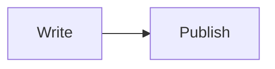

<div align="center">

# Satyam Sah — Portfolio

**A personal portfolio for my work, services, and writing.**

[](https://satyamsah.com)
[](https://nextjs.org/)
[](https://react.dev/)
[](https://www.typescriptlang.org/)
[](https://tailwindcss.com/)

[Explore the site](https://satyamsah.com) · [Read the blog](https://satyamsah.com/#writing) · [Message me on WhatsApp](https://wa.me/9779812039791)

</div>

---

## About

I’m **Satyam Sah**, a full-stack developer building responsive web products and applications. This repository contains my portfolio: selected projects, services, experience, skills, and articles about the web.

The site is built with the Next.js App Router and TypeScript. Blog articles are written in Markdown and rendered as statically generated pages. Visitors can contact me directly through WhatsApp.

## Features

- **Responsive portfolio** with sections for selected work, services, skills, journey, writing, and contact.
- **Dark and light themes** with a custom animated page-rebuild effect.
- **Markdown-powered blog:** write a Markdown file with frontmatter; posts are discovered automatically.
- **Rich article content:** GitHub-flavored Markdown, tables, code examples, and Mermaid diagrams.
- **Search and sharing metadata:** canonical URLs, Open Graph and Twitter cards, and `BlogPosting` structured data.
- **Crawler support:** generated `sitemap.xml` includes blog posts and their cover images; `robots.txt` points crawlers to the sitemap.
- **Direct contact:** project and contact links open WhatsApp with a message ready to send.

## Built with

| Area | Tools |
| --- | --- |
| Framework | Next.js 16 App Router, React 19 |
| Language | TypeScript |
| Styling | Tailwind CSS |
| Motion | Framer Motion, GSAP, Lenis |
| Blog content | Markdown, gray-matter, react-markdown, remark-gfm, Mermaid |
| Deployment | Vercel |

## Getting started

### Requirements

- Node.js **20.9 or newer**
- npm

### Install and run locally

```bash
git clone https://github.com/SatNarayanSah/satyam-profile.git
cd satyam-profile
npm install
npm run dev
```

Open [http://localhost:3000](http://localhost:3000). No environment variables are required for the portfolio or WhatsApp contact links.

### Available scripts

| Command | Description |
| --- | --- |
| `npm run dev` | Start the local development server. |
| `npm run build` | Create the production build. |
| `npm start` | Run the production server (after building). |
| `npm run lint` | Check the code with ESLint. |
| `npm run typecheck` | Run the TypeScript compiler without emitting files. |

## Writing a blog post

Add a `.md` file to [`content/blog/`](./content/blog). The filename becomes the post URL: `my-new-post.md` becomes `/blog/my-new-post`. Add the required YAML frontmatter, then write the article in Markdown:

````md
---
title: "My New Post"
description: "A concise summary for search results and article previews."
imageUrl: /images/my-new-post.png
date: "2026-11-10"
readTime: "5 min read"
category: "Web Development"
updatedAt: "2026-11-10"
---

## Start writing

Use **Markdown** for paragraphs, lists, links, and headings.

### Example

Fenced code blocks are displayed as code examples:

```ts
const greeting: string = "Hello, world!";
```

Tables use GitHub-flavored Markdown:

| Topic | Example |
| --- | --- |
| Content | Markdown |

Diagrams use Mermaid:


````

The `updatedAt` field is optional. Set it when you make a meaningful update; it is used for article metadata and the sitemap's last-modified date. Store cover images in `public/images/` and use their public path for `imageUrl`. See the [blog authoring guide](./content/blog/README.md) for more examples.

## Project structure

```text
content/blog/       Markdown articles and authoring guide
data/               Portfolio content and profile data
public/              Static images and assets
src/app/             Next.js pages, blog routes, sitemap, and robots rules
src/components/      Shared UI and portfolio sections
src/types/           TypeScript data types
```

## Deployment

The project can be deployed to [Vercel](https://vercel.com/) or another platform that supports Next.js:

1. Import the repository into your hosting provider.
2. Use `npm run build` as the build command.
3. Deploy the production output.
4. Configure the production domain as `https://satyamsah.com` (or update the canonical site URL in `src/app/layout.tsx` if using a different domain).
5. After deployment, submit `/sitemap.xml` in Google Search Console to help Google discover the site and its articles.

Search engines determine when to crawl and index pages; publishing a sitemap helps discovery but cannot guarantee instant indexing or search ranking.

## Contact

- **Portfolio:** [satyamsah.com](https://satyamsah.com)
- **WhatsApp:** [Start a conversation](https://wa.me/9779812039791)
- **GitHub:** [@SatNarayanSah](https://github.com/SatNarayanSah)
- **LinkedIn:** [Sat Narayan Sah](https://www.linkedin.com/in/satnarayansah/)

---

<div align="center">

Made with care by **Satyam Sah** · JanakpurDham, Nepal

</div>
