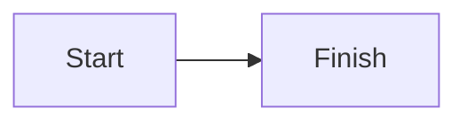

# Writing blog posts

Create one `.md` file per article in this folder. The filename becomes the post URL, for example `my-new-post.md` becomes `/blog/my-new-post`.

Add post details in YAML frontmatter, then write the article body in Markdown:

````md
---
title: "My New Post"
description: "A short summary for article cards and search results."
imageUrl: /images/my-new-post.png
date: "2026-11-10"
readTime: "5 min read"
category: "Web Development"
---

## Start writing

Use **Markdown** for paragraphs, lists, links, and headings.

### Example

Use a fenced code block with a language name:

```js
console.log("Hello, world!");
```

Use a `mermaid` fenced block for a rendered diagram:


````

Posts are discovered from this folder automatically. Headings containing "example" receive an Example label, code fences are labeled Code, and Mermaid fences render as diagrams.
