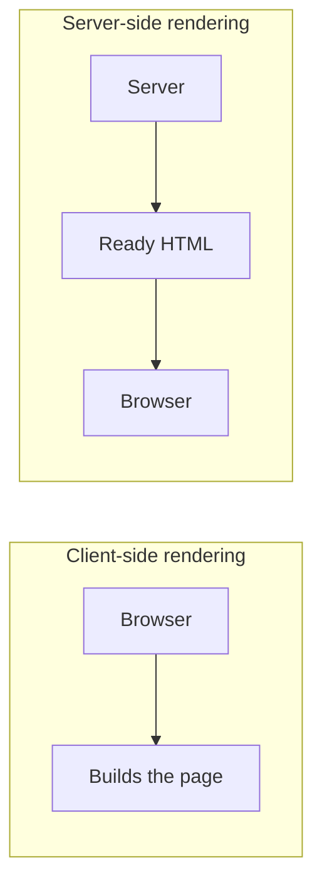

## What Is Rendering? (Let's Start Simple)

Before we compare CSR and SSR, we need to understand one word: rendering.

Rendering simply means turning code into something you can see on the screen. Your website is written in HTML, CSS, and JavaScript. The browser cannot show code to a user, so someone has to convert that code into real buttons, text, images, and layouts. That conversion is called rendering.

The big question is: WHO does this work and WHERE does it happen?

- If the browser (the user's device) does most of the work, it is called Client-Side Rendering (CSR).
- If the server does most of the work and sends a ready-made page, it is called Server-Side Rendering (SSR).

Think of it like a restaurant. In SSR, the kitchen cooks the full meal and the waiter brings it to your table, ready to eat. In CSR, the waiter brings you raw ingredients and a recipe, and you cook the meal yourself at the table. Both can end with a nice dinner, but the experience is very different.

## What Is Client-Side Rendering (CSR)?

In Client-Side Rendering, the server sends a almost empty HTML file and a big JavaScript file to the browser. Then the browser runs that JavaScript, fetches the data it needs, and builds the page on the user's device.

The HTML that the server sends usually looks like this:

```html
<div id='root'></div>
<script src='/bundle.js'></script>
```

See that empty div? That's it. The page is blank until JavaScript loads and fills it in. React apps made with Create React App or Vite (without any server setup) work this way.

CSR is the base idea behind Single Page Applications (SPAs), where you click around and the page changes instantly without a full reload.

## How CSR Works: Step by Step

Here is what happens when a user opens a CSR website:

- Step 1: The user types the URL and presses Enter.
- Step 2: The browser asks the server for the page.
- Step 3: The server sends back a tiny, almost empty HTML file plus links to JavaScript files.
- Step 4: The browser downloads the JavaScript (this can be large).
- Step 5: The browser runs the JavaScript.
- Step 6: The JavaScript calls an API to get data.
- Step 7: Once the data arrives, JavaScript builds the page and shows it.

Notice that the user sees a blank screen or a loading spinner during steps 3 to 7. That waiting time is the biggest weakness of CSR. After the first load though, moving between pages feels super fast because the browser already has everything it needs.

## Advantages of CSR

CSR is popular for good reasons:

- Smooth user experience: After the first load, page changes feel instant, just like a mobile app.
- Less load on the server: The server only sends files. The user's device does the heavy work, so hosting is cheap and easy.
- Easy hosting: You can host a CSR app on simple static hosting like Netlify, GitHub Pages, or any CDN.
- Great for interactive apps: Dashboards, chat apps, editors, and admin panels feel natural with CSR.
- Clear separation: Your frontend and backend are separate, which many teams find easy to manage.

## Disadvantages of CSR

CSR also has real problems you should know about:

- Slow first load: The user must wait for JavaScript to download and run before seeing content.
- Weaker SEO: Some search engine bots struggle to read content that only appears after JavaScript runs. Google can handle it better today, but it is slower and not always perfect. Other bots and social media preview crawlers (like WhatsApp or LinkedIn link previews) often see an empty page.
- Hard on slow devices: Old phones and slow networks suffer because the device has to do all the work.
- Blank screen risk: If the JavaScript fails or is blocked, the user sees nothing at all.
- Bigger bundles: As your app grows, your JavaScript file grows, and the first load gets heavier.

## What Is Server-Side Rendering (SSR)?

In Server-Side Rendering, the server builds the full HTML page for every request and sends it to the browser. The user receives a page that already has the real content inside it.

So when the browser gets the HTML, it can show the content immediately, even before JavaScript has finished loading. SSR is how websites worked in the old days with PHP and similar tools, and today modern frameworks like Next.js, Remix, Nuxt, and SvelteKit bring SSR back with a modern twist.

The HTML that arrives in SSR looks like this:

```html
<div id='root'>
  <h1>Welcome to My Blog</h1>
  <p>Here are the latest posts...</p>
</div>
```

The content is already there. No waiting for JavaScript to create it.

## How SSR Works: Step by Step

Here is the journey of an SSR page:

- Step 1: The user types the URL and presses Enter.
- Step 2: The browser asks the server for the page.
- Step 3: The server fetches the data it needs (from a database or API).
- Step 4: The server builds the complete HTML page with that data inside.
- Step 5: The server sends the ready HTML to the browser.
- Step 6: The browser shows the content right away. The user can already read the page.
- Step 7: The browser then downloads the JavaScript and makes the page interactive. This step is called hydration.

Hydration means attaching JavaScript to the HTML that is already on the screen so buttons, forms, and menus start working. Until hydration finishes, the page looks ready but may not respond to clicks yet. We will learn about hydration in detail in a future post of this series.

## Advantages of SSR

SSR solves many of the problems that CSR has:

- Faster first content: Users see real content quickly, which makes the site feel fast.
- Better SEO: Search engines get full HTML with all the text, so ranking and indexing are easier.
- Great social sharing: Link previews (title, image, description) work properly because the content is in the HTML.
- Works better on slow devices: The server does the heavy lifting, so weak phones have an easier time.
- Fresh data on every request: Since the page is built per request, users always see up-to-date information, like live prices or the latest news.

## Disadvantages of SSR

SSR is not perfect either:

- More server work: The server must build a page for every single visitor. High traffic means higher cost and more careful scaling.
- Slower server response (TTFB): The browser has to wait for the server to fetch data and build the HTML before getting anything. If your server or database is slow, the user waits.
- More complex setup: You need a running server (Node.js, for example), not just static file hosting.
- Page changes can feel heavier: Without extra tricks, moving between pages may need new requests to the server.
- Hydration cost: The page may look ready but not respond to clicks for a short time while JavaScript loads.

## CSR vs SSR: Side-by-Side Comparison

Here is a quick comparison to keep in your mind:

- Where is the page built? CSR: In the browser. SSR: On the server.
- What does the browser first receive? CSR: Empty HTML plus JavaScript. SSR: Full HTML with content.
- First load speed: CSR: Slower. SSR: Faster to show content.
- Moving between pages: CSR: Very fast after first load. SSR: Depends on your setup.
- SEO: CSR: Weaker. SSR: Stronger.
- Server cost: CSR: Low. SSR: Higher.
- Hosting: CSR: Simple static hosting. SSR: Needs a server or serverless functions.
- Best for: CSR: Dashboards, private apps, tools. SSR: Blogs, e-commerce, news, marketing sites.



## A Small Code Example: CSR

Here is a simple React component using CSR. The data is fetched in the browser after the page loads:

```jsx
import { useEffect, useState } from 'react';

export default function Posts() {
  const [posts, setPosts] = useState([]);
  const [loading, setLoading] = useState(true);

  useEffect(() => {
    fetch('/api/posts')
      .then((res) => res.json())
      .then((data) => {
        setPosts(data);
        setLoading(false);
      });
  }, []);

  if (loading) return <p>Loading...</p>;

  return (
    <ul>
      {posts.map((post) => (
        <li key={post.id}>{post.title}</li>
      ))}
    </ul>
  );
}
```

What happens here? The user first sees 'Loading...'. Only after the browser fetches the data does the list appear. A search engine bot that does not run JavaScript would only see 'Loading...'.

## A Small Code Example: SSR

Now here is the same idea with SSR, using a Remix or React Router style loader. The data is fetched on the server before the page is sent:

```jsx
import { useLoaderData } from 'react-router';

export async function loader() {
  const res = await fetch('https://api.example.com/posts');
  return res.json();
}

export default function Posts() {
  const posts = useLoaderData();

  return (
    <ul>
      {posts.map((post) => (
        <li key={post.id}>{post.title}</li>
      ))}
    </ul>
  );
}
```

What happens here? The loader runs on the server, gets the posts, and the server sends HTML that already contains the list. There is no 'Loading...' step for the first view. Search engines and users both see the real content immediately.

## Important Performance Terms You Should Know

When people compare CSR and SSR, they talk about a few common metrics. Here they are in simple words:

- TTFB (Time to First Byte): How long until the browser gets the first piece of data from the server. SSR is often slower here because the server is building the page.
- FCP (First Contentful Paint): When the user first sees any text or image. SSR usually wins here.
- LCP (Largest Contentful Paint): When the biggest main element (like a hero image or headline) appears. This is a Core Web Vital that Google cares about. SSR usually helps.
- TTI (Time to Interactive): When the page actually responds to clicks. In SSR, this can be later than FCP because of hydration. In CSR, FCP and TTI are often close together, but both come late.

A simple way to remember: SSR shows content sooner, but interactivity can come a little later. CSR shows content later, but once it appears it is usually ready to use.

## Real-World Examples

Let's connect this to websites you know:

- CSR is common in: Gmail, Figma, Trello, and many admin dashboards. These are apps you log into, where SEO does not matter and rich interaction matters a lot.
- SSR is common in: News websites, online stores like Amazon-style product pages, travel booking pages, and blogs. These need fast first views and good search ranking.
- Mixed approach: Many big sites today use both. The first page is server-rendered, and after that, the app behaves like a CSR app for smooth navigation. This is what Next.js, Remix, Nuxt, and SvelteKit do by default.

## When Should You Choose CSR?

Pick CSR when:

- Your app is behind a login (dashboards, admin panels, internal tools) and SEO does not matter.
- Your app is highly interactive, like a drawing tool, a chat app, or a code editor.
- You want the cheapest and simplest hosting.
- Your users are mostly on fast devices and good internet.
- You are building a quick prototype or a small side project.

## When Should You Choose SSR?

Pick SSR when:

- SEO is important for your business (blogs, shops, landing pages, news).
- You need great link previews on social media.
- Your content changes often and must be fresh for every visitor.
- Many of your users have slow phones or slow internet.
- You want users to see real content as fast as possible.

If your content does not change often, you may not even need SSR. In that case, Static Site Generation (SSG) can be even faster and cheaper. That is exactly what we will cover in the next topic of this series.

## Common Mistakes Beginners Make

Watch out for these traps:

- Thinking SSR is always better. It is not. If you build a private dashboard, SSR may add cost and complexity for no real benefit.
- Thinking CSR is bad for SEO always. Modern Google can index JavaScript pages, but it is slower and less reliable, so important public pages are safer with SSR.
- Ignoring the loading state in CSR. Always show a skeleton or spinner so users know something is happening.
- Using browser-only things in SSR code. Things like window, document, and localStorage do not exist on the server. Using them in server code will crash your page.
- Fetching data twice. In a mixed setup, make sure you do not fetch the same data on the server and again in the browser without need.
- Forgetting that SSR needs a fast server and fast data source. A slow database makes slow SSR.

## The Best of Both Worlds: Hybrid Rendering

Here is some good news: you do not have to pick only one. Modern frameworks let you mix approaches page by page.

- Your homepage and blog posts can be server-rendered for SEO and speed.
- Your user dashboard can be client-rendered for rich interaction.
- Your About page can be pre-built as a static page.

This is why learning each rendering style separately is so useful. Once you understand them, you can choose the best tool for every page instead of using one method for the entire website. In this Rendering series, we will go through all of these step by step: SSG, ISR, Streaming SSR, Hydration, Islands Architecture, and more.

## Quick Interview Questions and Answers

These are common questions you might face in interviews:

- Q: What is the main difference between CSR and SSR? A: In CSR the browser builds the page using JavaScript, while in SSR the server builds the HTML and sends it ready to show.
- Q: Why is SSR better for SEO? A: Because search engines receive full HTML with the content already inside, so they do not need to run JavaScript to read it.
- Q: Why can CSR have a slow first load? A: Because the browser must download, parse, and run JavaScript and then fetch data before showing anything.
- Q: What is hydration? A: It is the step where JavaScript attaches to server-rendered HTML to make it interactive.
- Q: Can I use both in one project? A: Yes. Frameworks like Next.js and Remix let you mix rendering methods for different pages.

## Final Summary and What's Next

Let's wrap it all up in simple words:

- CSR = The browser builds the page. Good for interactive apps. Weaker for first load and SEO.
- SSR = The server builds the page. Good for fast first view and SEO. Needs more server power.
- Neither is the winner. The right choice depends on what you are building.
- Most modern websites use a smart mix of both.

A simple rule to remember: if the page must be found on Google and show up fast, lean toward SSR. If it is a private, highly interactive app, CSR is often enough.

Next in the series: Static Site Generation (SSG). We will learn how to build pages ahead of time so they load almost instantly. Keep learning, keep building, and see you in the next post!
