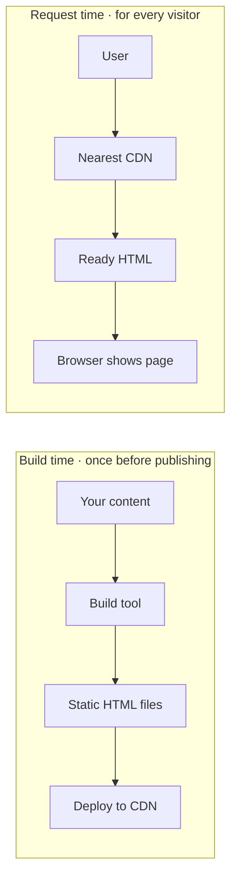

# Static Site Generation (SSG): A Simple and Complete Guide

*Category: Rendering · 11 min read · Published 2026-11-10*

---

## 1. A Quick Recap Before We Start

In the last post, we compared two ways of building a web page:

- **CSR (Client-Side Rendering):** The browser builds the page using JavaScript.
- **SSR (Server-Side Rendering):** The server builds the page every time someone asks for it.

Both methods do the work **after** the user asks for the page. That means the user always has to wait a little while the page is being built.

Now imagine a smarter idea: what if we build the page **before** anyone asks for it? Then, when a user arrives, we just hand over a page that is already finished. No waiting, no building. That idea is called **Static Site Generation**, or **SSG**.

---

## 2. What Is Static Site Generation (SSG)?

Static Site Generation means your pages are created **once, at build time**, and saved as plain HTML files. When a user visits your site, the server (or a CDN) simply sends that ready-made file.

**Build time** is the moment when you run a command like `npm run build`, just before you publish your website. During that moment, your tool goes through every page, fetches the data it needs, creates the final HTML, and saves it.

Let's use a simple example. Think about a bakery:

- With **SSR**, the baker makes a fresh cake every time a customer walks in. The customer waits.
- With **SSG**, the baker makes all the cakes early in the morning and puts them on the shelf. When a customer comes, they just pick one up and leave. Super fast!

---

## 3. How SSG Works: Step by Step

Here is the full journey of an SSG website:

1. You write your pages and components, just like normal.
2. You run the build command.
3. The build tool visits each page and fetches any data it needs (from files, a CMS, or an API).
4. It creates a complete HTML file for every page, along with the CSS and JavaScript files.
5. You upload these files to a host or CDN (like Netlify, Vercel, or Cloudflare).
6. A user opens your website.
7. The CDN instantly sends the ready-made HTML file from the server closest to the user.
8. The browser shows the page right away. JavaScript then loads and makes it interactive (this is called *hydration*, which we will study in a later post).

Notice what is missing: there is **no database call, no page building, and no waiting** when the user arrives. All the hard work was done earlier, only once.

---

## 4. Build Time vs Request Time

This is the most important idea in the whole topic, so let's make it clear.

- **Build time:** When you prepare and publish your website. It happens one time (or whenever you rebuild).
- **Request time:** When a real user opens a page. It can happen millions of times.

Here is how each rendering method uses these two moments:

- **CSR:** Does most of the work at request time, inside the user's browser.
- **SSR:** Does the work at request time, on the server.
- **SSG:** Does the work at build time. At request time, it only sends a file.

That is why SSG feels so fast. The expensive work is paid once by you, not again and again by every visitor.

### Diagram: How SSG Works



The top line is the slow work, and you do it **once**. The bottom line is what your visitors experience, and it is very quick because nothing needs to be built.

---

## 5. Advantages of SSG

SSG is loved by developers for many reasons:

- **Very fast:** Pages are ready-made files, so they load almost instantly.
- **Great SEO:** Search engines get complete HTML with all the content, just like SSR.
- **Cheap hosting:** You only need to host static files. Many platforms offer this for free.
- **Easy to scale:** Whether 10 people or 10 million people visit, the CDN just sends the same file. Your site will not crash from heavy traffic easily.
- **More secure:** There is no live server or database being hit for each visit, so there are fewer things for attackers to target.
- **Works on a CDN:** Your files can be copied to servers around the world, so users in Nepal, India, or the USA all get fast loading.
- **Reliable:** Even if your database or API goes down later, your already-built pages keep working.

---

## 6. Disadvantages of SSG

SSG is great, but it is not magic. Here are its limits:

- **Content can become old:** Because pages are built ahead of time, they do not change until you rebuild. If your price or news changes, the page still shows old data until the next build.
- **Long build times for big sites:** A site with 50,000 pages may take a long time to build, because every page must be created.
- **Not good for personal data:** A page that must show different things to each user (like your own account page) cannot be made ahead of time in the same way for everyone.
- **Needs a rebuild for updates:** Even fixing a small typo may need a new build and deploy (although automation makes this easy).
- **Not ideal for real-time features:** Live scores, stock prices, or chat need fresh data on every visit.

---

## 7. A Simple Code Example: React Router (Pre-rendering)

If you use React Router v7 (like in many Remix-style projects), you can tell the framework which pages to build ahead of time. You do this in the `react-router.config.ts` file:

```typescript
import type { Config } from '@react-router/dev/config';

export default {
  async prerender() {
    return ['/', '/about', '/blog'];
  },
} satisfies Config;
```

**What does this do?** When you run the build, the framework creates real HTML files for the home page, the about page, and the blog page. Visitors get those files instantly.

You can even build pages from your own data. For example, if you have a list of blog posts, you can make a page for each one:

```typescript
import { blogPosts } from '~/data/blogPosts';

export default {
  async prerender() {
    const postPaths = blogPosts.posts.map((post) => '/blog/' + post.slug);
    return ['/', '/blog', ...postPaths];
  },
} satisfies Config;
```

Now every blog post in your data file becomes its own static HTML page. Simple and powerful.

---

## 8. Another Example: Next.js

In Next.js (App Router), SSG works with a function called `generateStaticParams`. It tells Next.js which pages to create at build time:

```tsx
export async function generateStaticParams() {
  const res = await fetch('https://api.example.com/posts');
  const posts = await res.json();

  return posts.map((post) => ({ slug: post.slug }));
}

export default async function BlogPost({ params }) {
  const { slug } = await params;
  const res = await fetch('https://api.example.com/posts/' + slug);
  const post = await res.json();

  return (
    <article>
      <h1>{post.title}</h1>
      <p>{post.content}</p>
    </article>
  );
}
```

During the build, Next.js calls `generateStaticParams`, gets the list of posts, and creates one HTML page for each. The idea is the same in every framework: **decide the pages early, build them early, and serve them fast.**

---

## 9. Popular Tools for SSG

You do not need to build SSG from scratch. Many tools support it:

- **Next.js:** A very popular React framework with static generation built in.
- **React Router / Remix:** Supports pre-rendering for chosen pages.
- **Astro:** Made for content websites, ships very little JavaScript by default.
- **Gatsby:** An older React-based SSG tool, still used in many projects.
- **Eleventy (11ty):** A simple and flexible tool for blogs and documentation.
- **Hugo:** Famous for being extremely fast at building thousands of pages.
- **Jekyll:** One of the oldest SSG tools, popular with GitHub Pages.
- **Nuxt and SvelteKit:** Options for Vue and Svelte developers.

If you are a React developer, Next.js, React Router, or Astro are great places to start.

---

## 10. Where Does the Data Come From?

Since pages are built ahead of time, the data must be ready at build time. Common data sources are:

- **Local files:** Markdown files, JSON files, or a TypeScript file like the one you use for your blog posts.
- **A headless CMS:** Tools like Contentful, Sanity, Strapi, or WordPress used only as a content source.
- **APIs:** Your own backend or any public API.
- **A database:** Your build script can read from it once, then the data is baked into the HTML.

Remember: this data is read **once** during the build. If it changes later, you need to rebuild to update the pages. Many hosts offer a *webhook*, so when you publish new content in your CMS, a new build starts automatically.

---

## 11. SSG and Performance

SSG is usually the winner when it comes to speed. Let's look at the common metrics in simple words:

- **TTFB (Time to First Byte):** Very low, because the server only sends a file, especially from a CDN near the user.
- **FCP (First Contentful Paint):** Very fast, since the HTML already has the content.
- **LCP (Largest Contentful Paint):** Usually excellent, which is good for Google's Core Web Vitals.
- **TTI (Time to Interactive):** Depends on how much JavaScript you ship. Keep JavaScript small and this stays fast too.

A **CDN (Content Delivery Network)** is a group of servers around the world. It keeps copies of your static files, so a visitor in Biratnagar gets the page from a nearby server instead of one on the other side of the planet. This is a huge reason why SSG sites feel so quick.

---

## 12. SSG and SEO

SEO means helping search engines find and understand your pages. SSG is excellent for this:

- Every page is full HTML, so search bots can read all your text immediately.
- Pages load very fast, and Google likes fast pages.
- You can set unique titles, descriptions, and social preview images for each page at build time.
- Link previews on WhatsApp, LinkedIn, and X show properly because the information is already inside the HTML.

This is why blogs, documentation, portfolios, and company websites often choose SSG. They want to be found on search engines and load fast.

---

## 13. Real-World Uses of SSG

Where do you see SSG in real life?

- **Blogs and personal websites:** Content changes only when you publish a new post.
- **Documentation sites:** Guides and API docs are mostly the same for everyone.
- **Marketing and landing pages:** Pages made to attract customers need speed and SEO.
- **Portfolios:** Showcasing your work with fast loading.
- **Product catalogs with slow-changing data:** Small shops that do not change prices every minute.
- **Event and conference websites:** Schedules that rarely change.

Basically, if many people see the same content and it does not change every second, SSG is a strong choice.

---

## 14. When Should You Choose SSG?

Pick SSG when:

- Your content is the same for all users.
- Your content changes only now and then (daily, weekly, or monthly).
- You want the fastest possible loading speed.
- SEO is important.
- You want low hosting cost and high reliability.
- You expect traffic spikes and want your site to stay up easily.

---

## 15. When Should You Avoid SSG?

Think twice about SSG when:

- Your page shows personal data (like a user's profile, orders, or messages).
- Your data changes every few seconds (live scores, stock prices, chat).
- You have a huge number of pages (hundreds of thousands) and long builds would hurt your workflow.
- Content must be updated instantly for every visitor.

In these cases, SSR or CSR may fit better. Or you can use a smarter mix, like **Incremental Static Regeneration (ISR)**, which is the topic of our next post.

---

## 16. SSG vs SSR vs CSR: Quick Comparison

| | **SSG** | **SSR** | **CSR** |
|---|---|---|---|
| **When is the page built?** | At build time | On every request | In the browser after load |
| **First load speed** | Fastest | Fast | Slowest |
| **SEO** | Excellent | Excellent | Weaker |
| **Data freshness** | Old until rebuild | Always fresh | Fresh when fetched |
| **Server cost** | Lowest | Highest | Low |
| **Personalized content** | Hard | Easy | Easy |
| **Best for** | Blogs, docs, marketing | News, shops, live data | Dashboards, tools, private apps |

---

## 17. Common Mistakes Beginners Make

Avoid these traps:

- **Using SSG for pages that need live data.** Your users will see old information.
- **Forgetting to rebuild after changing content.** Set up automatic rebuilds with webhooks or a CI pipeline.
- **Putting secrets in the page.** Anything baked into static HTML is public, so never include private keys or private user data.
- **Building too many pages at once.** For very large sites, build only the most important pages ahead and handle the rest differently.
- **Using browser-only code at build time.** The build runs on a server or computer, where `window` and `document` do not exist.
- **Thinking static means boring.** A static site can still be fully interactive. "Static" only describes how the HTML is delivered, not how the page behaves after it loads.

---

## 18. Can a Static Site Be Dynamic?

Yes! Many beginners get confused by the word "static". A static site means the HTML files are ready-made. It does **not** mean the page cannot do anything.

After the page loads, JavaScript can:

- Fetch fresh data from an API (for example, show live comments or the latest price).
- Handle forms, search, and filters.
- Let users log in and see personal content.
- Run animations and interactive features.

So a common pattern is: build the main page layout and content with SSG for speed and SEO, then load personal or live parts with JavaScript in the browser. This gives you a fast start **and** a rich experience.

---

## 19. Quick Interview Questions and Answers

Practice these:

**Q: What is SSG?**
A: It is a rendering method where HTML pages are generated at build time and served as static files.

**Q: Why is SSG fast?**
A: Because pages are already built, so the server or CDN only needs to send a file with no extra work.

**Q: What is the biggest drawback of SSG?**
A: Content can become outdated until you rebuild and redeploy the site.

**Q: How is SSG different from SSR?**
A: SSG builds pages once at build time, while SSR builds the page again on every request.

**Q: Is SSG good for SEO?**
A: Yes, because search engines receive full HTML content immediately.

**Q: Can SSG pages be interactive?**
A: Yes, JavaScript can load after the HTML and add interactivity.

---

## 20. Final Summary and What's Next

Let's put it all together in simple words:

- **SSG** = Build pages ahead of time and serve them as ready-made files.
- It is very fast, great for SEO, cheap to host, and easy to scale.
- Its weakness is that content stays the same until you rebuild.
- It is best for blogs, docs, portfolios, and marketing pages.
- It is not ideal for live or personalized data.

> **A simple rule:** if everyone sees the same page and it does not change often, choose SSG.

But what if you have a big site and want fresh content without rebuilding everything? That's where our next topic comes in: **Incremental Static Regeneration (ISR)**. It gives you the speed of SSG with the freshness of SSR. See you in the next post!
